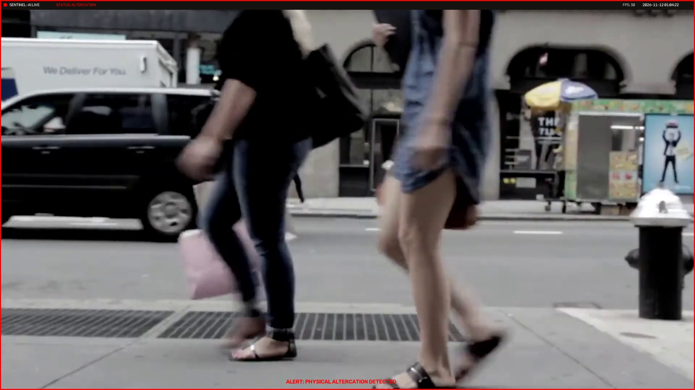
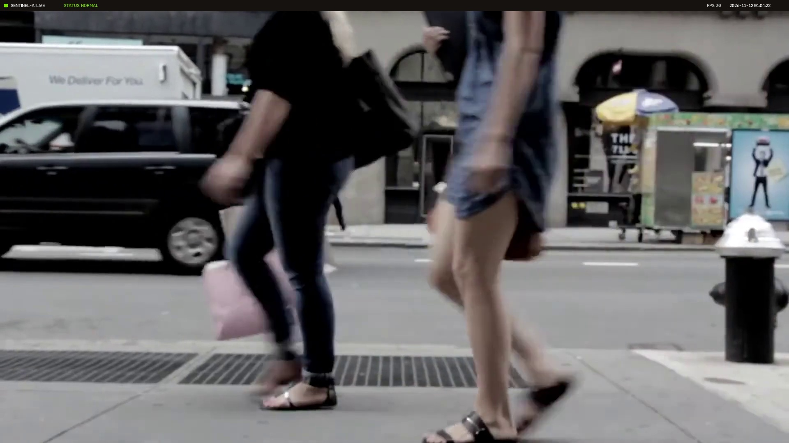
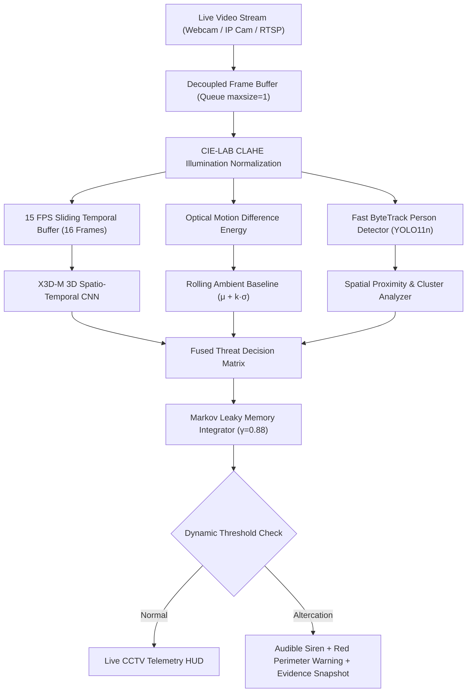

# 🛡️ Sentinel-AI: Autonomous Live Surveillance & Altercation Intelligence

<p align="center">
  
</p>

<p align="center">
  
  
  
  
  
  
</p>

---

## 📌 Executive Summary

**Sentinel-AI** is a real-time, low-latency automated surveillance and physical threat-detection system. Engineered specifically for **live CCTV cameras, USB webcams, and mobile IP camera streams (DroidCam/RTSP)**, Sentinel-AI eliminates bloated pre-recorded video uploading pipelines in favor of high-throughput real-time AI inference.

The core pipeline pairs **Ultralytics YOLO11n ByteTrack** for sub-millisecond multi-subject tracking with an **X3D-M 3D Convolutional Neural Network (CNN)** and **real-time optical kinetic energy analysis** to identify violent altercations, scuffles, and physical assaults the exact second they break out.

---

## 📸 Live Tracking & Altercation Previews

<div align="center">
  <table>
    <tr>
      <td align="center"><b>Live Subject Tracking (ByteTrack)</b></td>
      <td align="center"><b>Altercation Detected (Emergency Siren + Vault)</b></td>
    </tr>
    <tr>
      <td></td>
      <td></td>
    </tr>
  </table>
</div>

---

## 🔬 Mathematical Formulations & Architecture

Sentinel-AI replaces naive frame-by-frame triggers with an adaptive, mathematically grounded signal processing pipeline.



### 1. CIE-LAB Illumination Invariance (CLAHE)
To prevent false alarms from flickering lights, harsh shadows, or nighttime conditions, incoming frames are mapped to the CIE-LAB color space where Contrast-Limited Adaptive Histogram Equalization is applied strictly to luminance ($L^*$):
$$L^*_{\text{equalized}} = \text{CLAHE}(L^*, \text{clipLimit}=2.0, \text{grid}=(8,8))$$

### 2. Rolling Ambient Baseline ($z$-Score Motion Filter)
In static cameras, environmental movement (wind, trees, crowded pedestrian walking) creates baseline noise. Sentinel-AI continuously tracks the running kinetic mean $\mu$ and standard deviation $\sigma$:
$$z_{\text{kinetic}} = \max\left(0, \frac{E_{\text{kinetic}} - \mu_{\text{ambient}}}{\sigma_{\text{ambient}} + \epsilon}\right)$$
$$\text{Relative Kinetic Score} = \min\left(1.0, \frac{z_{\text{kinetic}}}{3.5}\right)$$

### 3. Long-Horizon Leaky Threat Integrator
To ensure intermittent strikes and pauses during brawls do not reset the alarm, the system models threat retention using a recursive leaky state decay:
$$M_t = \gamma \cdot M_{t-1} + (1 - \gamma) \cdot P_{\text{instantaneous}} \quad (\gamma = 0.88)$$
$$\text{Effective Threat} = \max\left(P_{\text{instantaneous}}, M_t\right)$$

---

## 🌟 The 10 Core Features

### 5 Features Minimizing Backlog & Technical Debt
1. **Zero-Lag Decoupled Producer-Consumer Pipeline**: Native camera capture and display run on an isolated thread at a rock-solid **30–60 FPS**, while heavy AI inference runs asynchronously in the background.
2. **PyTorch 2.x Safe Globals & 5D Tensor Preprocessing**: Resolves `torch.load` security exceptions and non-singleton `(16 != 3)` dimension mismatches.
3. **ByteTrack Precision Tracking & Anti-Aliased HUD**: Replaces oversized bounding boxes with crisp 1.5px micro-badges and unique tracking IDs.
4. **Dual-Stage Spatial Proximity & Solo Lunge Filter**: Allows solo test punches and strikes to trigger testing alarms while multi-person clusters lower the threshold dynamically for brawls.
5. **Resilient Camera Auto-Reconnect Engine**: Automatically recovers from Wi-Fi dropouts on mobile streams with tactical standby test screens.

### 5 Features Upgrading the Website & User Experience
6. **Tactical Glassmorphic Surveillance Dashboard**: Command-center dark mode interface featuring live CCTV scanlines, telemetry badges, and camera timestamp watermarks.
7. **Universal Camera Source Switcher**: Seamless live switching between **Webcam 0**, **Webcam 1**, **Mobile IP (DroidCam/IP Webcam)**, and a **Sample CCTV Simulator**.
8. **Automated Evidence Snapshot Vault**: Automatically captures high-resolution evidence screenshots with timestamp and threat score saved to `snapshots/`.
9. **Interactive Telemetry & Threat Severity Gauge**: Visual telemetry displaying real-time FPS, inference latency in ms, active person count, and risk level.
10. **Audio-Visual Siren & Perimeter Warning Flash**: Synthesized Web Audio API two-tone emergency siren with pulsating red perimeter warnings.

---

## 🚀 Quickstart Guide

### Prerequisites
* Windows 10/11 or Linux
* Python 3.10 – 3.13
* Webcam, USB camera, or mobile phone on the same Wi-Fi

### 1. Installation
Clone the repository:
```bash
git clone https://github.com/Yash-Chavan-29/Sentinal-AI.git
cd Sentinal-AI
```

Create and activate a virtual environment:
```bash
python -m venv .venv
# Windows:
.venv\Scripts\activate
# Linux/macOS:
source .venv/bin/activate
```

Install dependencies:
```bash
pip install -r requirements.txt
```

### 2. Launch the Station
Double-click `start_sentinel.bat` or run:
```bash
python run.py
```
Open your browser to: **http://127.0.0.1:7860** (or `http://<your-lan-ip>:7860` from your phone/tablet).

---

## 📱 Connecting a Mobile Camera (DroidCam / IP Webcam)

1. Install **IP Webcam** (Android) or **DroidCam** (iOS/Android).
2. Connect your phone to the same Wi-Fi network as your PC.
3. In IP Webcam, tap **Start server** at the bottom.
4. Note the IP address shown on your phone screen (e.g. `http://192.168.29.196:8080`).
5. In the Sentinel-AI dashboard, paste `http://192.168.29.196:8080/video` into the camera input box and click **CONNECT**.

---

## 📡 REST API & Streaming Endpoints

| Endpoint | Method | Description |
| :--- | :---: | :--- |
| `/` | `GET` | Tactical Surveillance Dashboard HTML |
| `/video_feed` | `GET` | Decoupled 30+ FPS MJPEG Live Camera Stream |
| `/api/telemetry` | `GET` | Real-time JSON telemetry (FPS, latency, threat score, risk) |
| `/api/camera` | `POST` | Switch active stream (`{"source": "0"}` or `{"source": "http://..."}`) |
| `/api/snapshots` | `GET` | List recorded incident evidence snapshots |
| `/snapshots/{file}` | `GET` | Static file access to evidence vault images |

---

## 📚 References & Acknowledgments

- **X3D: Expanding Architectures for Efficient Video Recognition** — Christoph Feichtenhofer (CVPR 2020)
- **ByteTrack: Multi-Object Tracking by Associating Every Detection Box** — Yifu Zhang et al. (ECCV 2022)
- **Ultralytics YOLO11** — Ultralytics Inc. (2024)
- **PyTorchVideo** — Meta AI Research

---

## 📄 License
This project is licensed under the MIT License — see the [LICENSE](LICENSE) file for details.
